# github-status

[English](README.md) | **한국어**

GitHub 활동 통계를 모아 **랭크(S ~ C)** 를 매기고, 통계 카드와 **업적(achievement) 메달**을 SVG로 만들어 주는 도구입니다.
의존성 없이 Node.js만으로 동작하며, GitHub Actions가 매일 SVG를 갱신해 `generated/`에 커밋합니다.




   

> 위 이미지는 `Update GitHub stats` 워크플로가 처음 실행된 뒤부터 표시됩니다.

## 생성되는 파일

| 파일 | 내용 |
| --- | --- |
| `generated/stats.svg` | 통계 + 랭크 카드. 막대는 각 지표가 랭크에 기여하는 점수입니다 |
| `generated/achievements.svg` | 업적 8종을 한 장에 모은 카드 |
| `generated/badges/rank.svg` | 랭크 메달 |
| `generated/badges/{stars,commits,prs,issues,reviews,followers,repos,contributions}.svg` | 업적별 메달 (배경 투명) |
| `generated/stats.json` | 원본 수치, 랭크, 업적 등급 |

카드 두 장은 보는 사람의 라이트/다크 설정을 따라갑니다.

다른 저장소(예: 프로필 README)에서는 이렇게 씁니다.

```md

/github-status/main/generated/badges/stars.svg" width="80">
```

## 업적

메달은 움직이는 만화 스티커처럼 그립니다. 단색 셀 셰이딩, 굵은 외곽선, 튀어나오는 효과 테두리, 깜빡이는 집중선, 통통 튀는 아이콘이 들어갑니다.
수치가 목표를 넘을 때마다 메달 등급이 올라가고, 등급이 높을수록 광택 줄기, 강조선, 두 번째 효과 테두리, 색 변화가 더해집니다.
아직 못 딴 업적은 회색 메달에 진행도(`7/10`)가 표시됩니다.

| 업적 | 기준 | Bronze | Silver | Gold | Diamond |
| --- | --- | ---: | ---: | ---: | ---: |
| Star Collector | 받은 스타 | 10 | 50 | 200 | 1,000 |
| Committer | 커밋 | 100 | 500 | 2,000 | 10,000 |
| Merge Maker | Pull Request | 10 | 50 | 200 | 1,000 |
| Issue Scout | 이슈 | 10 | 50 | 200 | 500 |
| Keen Reviewer | 리뷰 | 5 | 25 | 100 | 500 |
| Crowd Magnet | 팔로워 | 10 | 50 | 200 | 1,000 |
| Repo Builder | 소유 저장소 | 5 | 20 | 50 | 100 |
| Collaborator | 기여한 저장소 | 3 | 10 | 30 | 100 |

랭크 메달은 S가 Diamond, A 계열이 Gold, B 계열이 Silver, C 계열이 Bronze입니다.
기준은 `src/achievements.js`의 `ACHIEVEMENTS`에서 바꿀 수 있습니다.

## 랭크 계산

각 지표를 기준값(median)으로 정규화한 뒤 가중 평균으로 백분위(상위 N%)를 구합니다.
[github-readme-stats](https://github.com/anuraghazra/github-readme-stats)와 같은 방식입니다.

| 지표 | 기준값 | 가중치 |
| --- | ---: | ---: |
| 커밋 (전체 기간) | 1000 | 2 |
| Pull Request | 50 | 3 |
| 이슈 | 25 | 1 |
| 리뷰 | 2 | 1 |
| 스타 | 50 | 4 |
| 팔로워 | 10 | 1 |

| 랭크 | S | A+ | A | A- | B+ | B | B- | C+ | C |
| --- | --- | --- | --- | --- | --- | --- | --- | --- | --- |
| 상위 | 1% | 12.5% | 25% | 37.5% | 50% | 62.5% | 75% | 87.5% | 100% |

## 사용법

### GitHub Actions (자동)

`.github/workflows/update-stats.yml`이 매일 한 번, 그리고 수동 실행(`workflow_dispatch`) 시 저장소 소유자의 통계를 갱신합니다.

- 기본 토큰으로는 공개 활동만 집계됩니다.
- 비공개 저장소의 기여까지 포함하려면 `repo`, `read:user` 권한의 Personal Access Token을
  `GH_STATS_TOKEN` 시크릿으로 등록하세요.

### 로컬 실행

개발 환경은 Nix flake로 관리합니다.

```sh
# 실제 데이터로 생성 (generated/ 에 기록)
GITHUB_TOKEN=<token> nix develop -c node src/index.js --user <login>

# API 호출 없이 예시 데이터로 미리보기 (demo/ 에 기록)
nix develop -c npm run demo

# 테스트
nix develop -c npm test
```

| 옵션 | 설명 | 기본값 |
| --- | --- | --- |
| `-u, --user <login>` | GitHub 로그인 | `$GITHUB_REPOSITORY_OWNER` |
| `-o, --out <dir>` | 출력 디렉터리 | `generated` |
| `-t, --theme <theme>` | 카드 테마: `auto`, `light`, `dark` | `auto` |
| `--fixture <file>` | API 대신 JSON 파일에서 통계 읽기 | |

## License

[Apache License 2.0](LICENSE)
