# github-status

**English** | [한국어](README.ko.md)

Collects your GitHub activity, ranks it (**S to C**), and renders a stats card and **achievement medals** as SVG.
It is a GitHub Action with no dependencies: add it to a workflow and it refreshes the SVGs and commits them to `generated/`.




   

> These images appear once the `Update GitHub stats` workflow has run for the first time.

## Generated files

| File | Contents |
| --- | --- |
| `generated/stats.svg` | Stats and rank card. Each bar is that metric's score towards the rank |
| `generated/achievements.svg` | All eight achievements on one card |
| `generated/badges/rank.svg` | Rank medal |
| `generated/badges/{stars,commits,prs,issues,reviews,followers,repos,contributions}.svg` | One medal per achievement (transparent background) |
| `generated/stats.json` | Raw numbers, rank and achievement tiers |

The two cards follow the viewer's light or dark colour scheme.

To use them from another repository, such as your profile README:

```md

/github-status/main/generated/badges/stars.svg" width="80">
```

## Achievements

Medals are drawn like animated cartoon stickers: flat cel-shaded colours, thick outlines, a popping impact burst, flickering focus lines and a bouncing icon.
A medal moves up a tier each time its number passes a goal, and higher tiers add more: a gloss sweep, emphasis marks, a second burst and colour cycling.
An achievement you have not unlocked yet is a grey medal showing progress (`7/10`).

| Achievement | Counts | Bronze | Silver | Gold | Diamond |
| --- | --- | ---: | ---: | ---: | ---: |
| Star Collector | Stars received | 10 | 50 | 200 | 1,000 |
| Committer | Commits | 100 | 500 | 2,000 | 10,000 |
| Merge Maker | Pull requests | 10 | 50 | 200 | 1,000 |
| Issue Scout | Issues | 10 | 50 | 200 | 500 |
| Keen Reviewer | Reviews | 5 | 25 | 100 | 500 |
| Crowd Magnet | Followers | 10 | 50 | 200 | 1,000 |
| Repo Builder | Repositories owned | 5 | 20 | 50 | 100 |
| Collaborator | Repositories contributed to | 3 | 10 | 30 | 100 |

The rank medal is Diamond for S, Gold for the A ranks, Silver for the B ranks and Bronze for the C ranks.
Change the goals in `ACHIEVEMENTS` in `src/achievements.js`.

## How the rank is calculated

Each metric is normalised against a median value, and the weighted average gives a percentile (top N%).
This is the same model as [github-readme-stats](https://github.com/anuraghazra/github-readme-stats).

| Metric | Median | Weight |
| --- | ---: | ---: |
| Commits (all time) | 1000 | 2 |
| Pull requests | 50 | 3 |
| Issues | 25 | 1 |
| Reviews | 2 | 1 |
| Stars | 50 | 4 |
| Followers | 10 | 1 |

| Rank | S | A+ | A | A- | B+ | B | B- | C+ | C |
| --- | --- | --- | --- | --- | --- | --- | --- | --- | --- |
| Top | 1% | 12.5% | 25% | 37.5% | 50% | 62.5% | 75% | 87.5% | 100% |

## Usage

### GitHub Action

Add this workflow to any repository, for example your profile repository (`<user>/<user>`).
It writes the SVGs to `generated/` and commits them whenever your numbers change. Nothing needs to be installed.

```yaml
# .github/workflows/stats.yml
name: Update GitHub stats
on:
  schedule:
    - cron: "17 0 * * *"
  workflow_dispatch:

permissions:
  contents: write

jobs:
  stats:
    runs-on: ubuntu-latest
    steps:
      - uses: actions/checkout@v5
      - uses: jihoo12/github-status@v0.1
```

Then link the images from your README:

```md


```

| Input | Description | Default |
| --- | --- | --- |
| `token` | Token used to read the stats and push the commit | `${{ github.token }}` |
| `user` | GitHub login to generate stats for | Repository owner |
| `output-dir` | Directory the files are written to | `generated` |
| `theme` | Card theme: `auto`, `light`, `dark` | `auto` |
| `commit` | Commit and push the output directory when it changed | `true` |
| `commit-message` | Message of that commit | `Update GitHub stats` |

| Output | Description |
| --- | --- |
| `rank` | Rank level, `S` to `C` |
| `percentile` | Top N% (lower is better) |
| `committed` | `true` when a commit was pushed |

- The default token only counts public activity. To include contributions to private repositories, create a personal access token with the `repo` and `read:user` scopes, save it as a secret and pass it: `token: ${{ secrets.GH_STATS_TOKEN }}`.
- Committing needs `permissions: contents: write`. Set `commit: false` to only write the files and handle them yourself.
- Each run adds the rank and achievement table to the workflow run summary.

### Running locally

The development environment is a Nix flake.

```sh
# Generate from real data (writes to generated/)
GITHUB_TOKEN=<token> nix develop -c node src/index.js --user <login>

# Preview with sample data, no API calls (writes to demo/)
nix develop -c npm run demo

# Tests
nix develop -c npm test
```

| Option | Description | Default |
| --- | --- | --- |
| `-u, --user <login>` | GitHub login | `$GITHUB_REPOSITORY_OWNER` |
| `-o, --out <dir>` | Output directory | `generated` |
| `-t, --theme <theme>` | Card theme: `auto`, `light`, `dark` | `auto` |
| `--fixture <file>` | Read stats from a JSON file instead of the API | |

## License

[Apache License 2.0](LICENSE)
